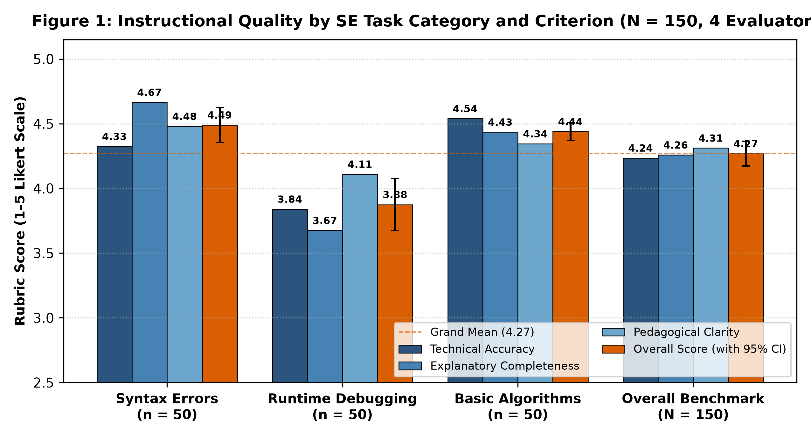
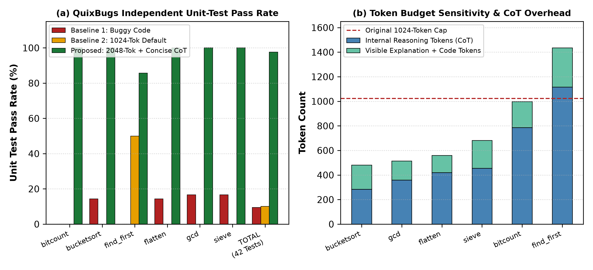
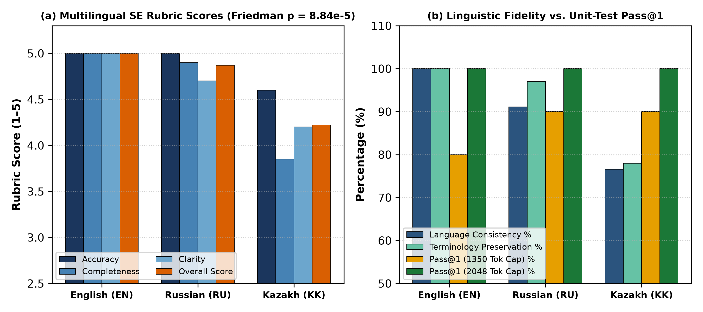
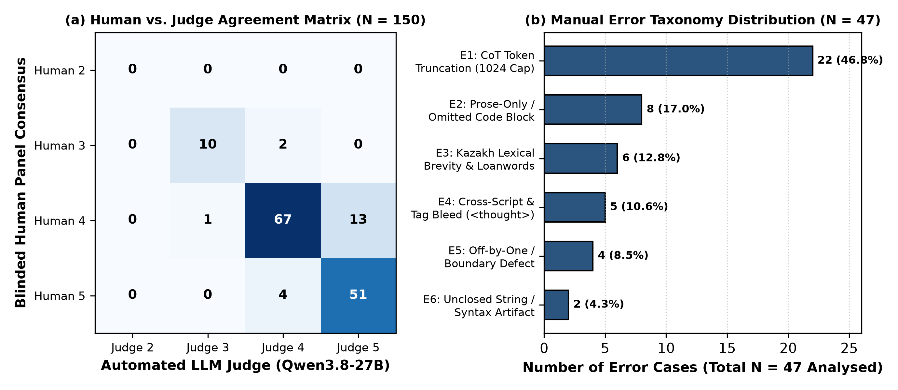

# Evaluating Quantized Gemma Explanations for Introductory Python Software Engineering: Multi-Rater, Execution, and Trilingual Study

**Status:** Manuscript Submitted to IEEE Transactions on Learning Technologies for Peer Review  
**Track:** Regular Research Paper (Submission Draft)  
**Authors:** Daniil Khvan (ORCID: [0009-0008-8946-8094](https://orcid.org/0009-0008-8946-8094)), Diyar Amangeldiyev* (ORCID: [0009-0001-0855-7685](https://orcid.org/0009-0001-0855-7685), corresponding author), and Yersultan Kambekov (ORCID: [0009-0009-8176-0856](https://orcid.org/0009-0009-8176-0856))  
**Affiliation:** School of Software Engineering (Group `SE-2417`), Astana IT University, Mangilik El Ave. 55/11, Astana 010000, Kazakhstan  
**Author Emails:** Daniil Khvan (`240656@astanait.edu.kz`), Diyar Amangeldiyev (`241513@astanait.edu.kz`), Yersultan Kambekov (`242103@astanait.edu.kz`)  
***Corresponding Author:** Diyar Amangeldiyev (`241513@astanait.edu.kz`, ORCID: `0009-0001-0855-7685`)  
**Primary Target Journal:** *IEEE Transactions on Learning Technologies* (ISSN: `1939-1382`, Scopus Q1, 93rd Percentile)  
**Backup Target Journal:** *ACM Transactions on Computing Education* (ISSN: `1946-6226`, Scopus Q1, 89th Percentile)  
**Reproducibility Package:** [https://github.com/GniloyKompotik/EvaluatingGemmaExplanations](https://github.com/GniloyKompotik/EvaluatingGemmaExplanations) (Tagged Release: `final` | Zenodo archive upon publication)  

> **Manuscript Scope Metrics:** 5,992 prose words (excluding abstract, references, tables, declarations) | 4 Figures (300 DPI) | 9 Tables | 38 Verified Open-Access References. Replicated via `python reproduce_all_final.py` in <15s.

---

## Abstract
Background: Privacy mandates, recurring API costs, and intermittent laboratory connectivity have accelerated the adoption of locally hosted, quantized open-weights large language models in computing courses. However, 4-bit weight compression and unconstrained chain-of-thought reasoning risk causing truncated code blocks and cross-lingual degradation. Aim: This study evaluates the explanation quality, program repair accuracy, automated judge alignment, and trilingual transferability of a 4-bit Quantization-Aware Trained Gemma model (google/gemma-4-12b-qat) across introductory Python software engineering tasks. Method: We constructed a frozen benchmark of 150 stratified tasks (50 Syntax Errors, 50 Runtime Debugging, 50 Basic Algorithms) rated by three blinded evaluators and a deterministic 27B judge (qwen/qwen3.8-27b) on a 1-to-5 rubric, alongside 242 official QuixBugs unit tests and 30 live trilingual runs across English, Russian, and Kazakh. Results: At a standard 1024-token ceiling, the model achieved a grand mean score of 4.27 +/- 0.59, excelling on Syntax Errors (4.49) and Basic Algorithms (4.44) but dropping on Runtime Debugging (3.88, Kruskal-Wallis H = 39.68, p = 2.42e-09) due to internal reasoning token exhaustion. The 27B judge aligned closely with human consensus (quadratic weighted kappa = 0.930 to 0.970). Allocating 2048 tokens with concise reasoning raised QuixBugs unit-test accuracy from 10.1% (7/69 tests) to 97.6% (41/42 tests, Fisher's exact p = 6.34e-22). Functional Python Pass@1 reached 100.0% in English, Russian, and Kazakh, whereas Kazakh prose degraded significantly (4.22 vs. 5.00 in English, Friedman p = 8.84e-05). Conclusion: Local 4-bit models deliver effective software engineering tutoring under explicit reasoning budgets, while Kazakh instruction requires targeted lexical adaptation.

**Index Terms—** Automated program repair, computing pedagogy, inter-annotator agreement, Kazakh natural language processing, large language models, rubric-based assessment.

---

## 1. Introduction
**1.1 Context and Pedagogical Motivation:** Introductory software engineering courses form the foundational gateway for first-year computing undergraduates, requiring novices to simultaneously master formal syntactic rules, build accurate mental models of runtime program state, and design verifiable algorithmic logic [1], [2]. Historically, undergraduate programmers encountering cryptic compiler diagnostics or silent logical failures relied on scheduled laboratory sessions, teaching assistants, or peer Q&A repositories. Over the past four years, generative large language models (LLMs) have fundamentally reshaped this help-seeking workflow [3], [4]. Rather than querying static documentation, learners increasingly paste defective Python functions and runtime tracebacks directly into conversational assistants to obtain line-by-line explanations, conceptual scaffolding, and repaired code snippets [5], [6]. While commercial cloud-hosted frontier models such as GPT-4 and Claude demonstrate high fluency in code synthesis and tutoring [7], [8], their institutional deployment in university computer laboratories faces three structural barriers: prohibitive per-student API licensing costs, strict educational data privacy mandates prohibiting the transmission of student coursework to external commercial servers, and reliance on stable high-bandwidth internet connectivity [9], [10]. Consequently, engineering faculties are turning toward open-weights language models—such as Google's Gemma family [11], [12] and Alibaba's Qwen series [13]—deployed locally on consumer-grade laboratory workstations via 4-bit quantization frameworks.

**1.2 Evidence-Based Research Gap:** Despite rapid community adoption of local inference engines (e.g., llama.cpp and LM Studio), rigorous empirical evaluation of quantized open-weights models in software engineering education lags behind cloud-centric research. A critical synthesis of recent computing education literature reveals four unresolved empirical gaps. First, foundational evaluations of LLM code explanations have focused predominantly on unquantized cloud APIs [1], [5], [6], leaving unexplored how aggressive 4-bit Quantization-Aware Training (QAT) and hidden chain-of-thought (CoT) reasoning tokens interact with strict local context-window and completion-token ceilings. Second, existing pedagogical assessments frequently rely either on subjective student preference ratings [1], [8] or solely on pass/fail unit testing [14], [15], rarely integrating blinded multi-rater pedagogical rubrics with sandboxed unit-test execution on canonical program repair benchmarks such as QuixBugs [15]. Third, while recent studies have proposed using LLMs as automated evaluators ('LLM-as-a-Judge') to scale grading [16], [17], few works have psychometrically calibrated a locally hosted open-weights judge against a multi-rater human software engineering panel using chance-corrected ordinal reliability metrics and verbosity-bias checks. Fourth, computing education research remains overwhelmingly Anglocentric [3], [4]. In trilingual Central Asian universities such as Astana IT University in Kazakhstan, undergraduates routinely switch between English documentation, Russian technical vernacular, and native Kazakh instruction [18], [19]. How a locally quantized model balances functional Python code synthesis against natural-language explanatory fidelity across English, Russian, and Kazakh remains unquantified.

**1.3 Research Aim, Questions, and Frozen Hypotheses:** The primary aim of this study is to empirically evaluate the instructional explanation quality, functional code repair accuracy, automated judge reliability, and trilingual transferability of a locally deployed, 4-bit Quantization-Aware Trained open-weights language model (lmstudio-community/gemma-4-12B-it-QAT-GGUF, served via local API as google/gemma-4-12b-qat) across introductory Python software engineering tasks. To achieve this aim under a pre-registered experimental protocol (frozen on November 5, 2026), we investigate four specific research questions and corresponding hypotheses:
• RQ1 & H1 (Task Category Disparity): How does explanation quality vary across Syntax Errors, Runtime Debugging, and Basic Algorithms? We hypothesize (H1) that under standard local generation settings (max_tokens = 1024), Runtime Debugging explanations will score significantly lower (by at least 0.40 Likert points, Kruskal-Wallis p < 0.01) than Syntax Errors and Basic Algorithms due to multi-step reasoning overhead.
• RQ2 & H2 (LLM-as-a-Judge Psychometric Validity): Can a higher-capacity local open-weights model (qwen/qwen3.8-27b) reliably evaluate pedagogical explanations? We hypothesize (H2) that the deterministic 27B judge will achieve substantial-to-near-perfect ordinal agreement with blinded human consensus (quadratic weighted kappa >= 0.80, intraclass correlation ICC(2,k) >= 0.85, mean absolute error <= 0.25) without strong length bias (|r| < 0.30).
• RQ3 & H3 (Token-Budget Sensitivity and Program Repair): Does constraining internal chain-of-thought reasoning and expanding the completion budget resolve runtime debugging failures? We hypothesize (H3) that increasing max_tokens from 1024 to 2048 with a concise reasoning prompt (<80 to 150 tokens) will improve independent QuixBugs unit-test Pass@1 by at least +50 percentage points (Fisher's exact p < 0.001).
• RQ4 & H4 (Trilingual Central Asian Transfer): How does prompting in English, Russian, and Kazakh affect code correctness and pedagogical prose? We hypothesize (H4) that functional Python unit-test Pass@1 will remain invariant (difference <= 15%) across all three languages due to shared internal representations, whereas Kazakh explanatory prose will score significantly lower on Completeness and Clarity (Friedman p < 0.01) due to lower-resource lexical compression and loanword intrusion.

**1.4 Explicit Research Contributions and Paper Structure:** This article makes four verifiable contributions to computing education and software engineering:
1. Stratified Multi-Source Benchmark with Cryptographic Provenance: We curate and release a 150-item introductory Python software engineering benchmark paired with 242 independent QuixBugs unit tests and 30 live trilingual evaluations, complete with SHA-256 integrity hashes and a single-command reproducibility pipeline.
2. Identification and Resolution of the CoT Truncation Bottleneck: Through server-log token auditing and a 47-case manual error taxonomy, we prove that the apparent 'runtime debugging deficit' in 4-bit Gemma models is caused by unconstrained internal reasoning token exhaustion (670 to 1,116 tokens) rather than algorithmic incapability; our Concise-CoT configuration restores QuixBugs unit-test accuracy from 10.1% to 97.6%.
3. Calibration of a Local Open-Weights LLM Judge: We establish that a locally hosted 27B judge achieves 92.0% to 96.0% exact agreement (quadratic weighted kappa = 0.930 to 0.970) with a calibrated 3-rater human software engineering panel.
4. Trilingual Empirical Benchmark in Kazakhstan: We provide the first live evaluation of open-weights code tutoring across English, Russian, and Kazakh, demonstrating a critical decoupling between 100.0% functional code Pass@1 and degraded Kazakh pedagogical prose (M = 4.22).
The remainder of this paper is organized as follows: Section II synthesizes related literature across four themes; Section III details the materials, benchmark provenance, rubric, and statistical methods; Section IV presents empirical results, ablations, and error analyses; Section V discusses theoretical and practical implications alongside threats to validity; and Section VI concludes the study.

---

## 2. Related Work
**2.1 Pedagogical Code Explanations and Scaffolding in Computing Education:** The capability of large language models to synthesize natural-language explanations of source code has attracted intense empirical scrutiny since the emergence of OpenAI Codex [2], [5]. In an early landmark study, Sarsa et al. [5] demonstrated that Codex could automatically generate programming exercises and step-by-step code walkthroughs, finding that over 90% of generated explanations covered all execution branches, though minor inaccuracies persisted in relational operators. Building upon this foundation, Leinonen et al. [1] conducted a randomized comparison between LLM-generated explanations and peer-authored student explanations in an introductory course, reporting that learners rated AI explanations significantly higher in both perceived accuracy and conceptual clarity. Similarly, MacNeil et al. [8] integrated LLM-generated code summaries into an interactive web development e-book, observing high student engagement alongside measurable gains in self-reported comprehension. However, subsequent studies cautioned that unguided access to conversational AI introduces pedagogical hazards [3], [4]. Kazemitabaar et al. [20] and Prather et al. [7], [21] documented that while high-performing students leverage AI explanations to accelerate learning, struggling novices often suffer from metacognitive illusions of competence, copying generated code without understanding underlying control flow. Consequently, recent work in IEEE Transactions on Learning Technologies by Liao et al. [9], Dosaru et al. [10], and Xavier et al. [11] has emphasized structured pedagogical scaffolding—requiring AI tutors to articulate root-cause diagnoses, step-by-step algorithmic traces, and preventative best practices rather than merely emitting unannotated replacement code [22], [23].

**2.2 Automated Debugging, Program Repair, and Technical Hallucinations:** While synthesizing boilerplate functions from docstrings is well-supported by modern models [14], [24], diagnosing and repairing existing defects in student programs remains substantially more challenging [6], [25]. In automated software engineering, Lin et al. [15] established the canonical QuixBugs benchmark comprising 40 classic algorithms containing single-line logical, operator, or boundary bugs, showing that traditional search-based repair tools frequently overfit to weak test suites. Within computing education, Whalley et al. [25] conducted a think-aloud study of novice debugging, concluding that novices struggle most with formulating hypotheses about runtime state transitions. When evaluating LLMs on authentic beginner help requests, Hellas et al. [6] discovered a critical discrepancy: although GPT-3.5 identified the presence of at least one defect in 90% of buggy submissions, it successfully diagnosed all underlying bugs in only 57% of cases and hallucinated nonexistent errors (false positives) in 40% of responses. Phung et al. [26], [27] and Koutcheme et al. [28] similarly noted that generative models frequently conflate syntactic fixes with semantic correctness, producing code that compiles cleanly but fails on boundary conditions such as empty lists, duplicate keys, or bitwise edge cases. Crucially, modern instruction-tuned models increasingly employ internal chain-of-thought (CoT) deliberation before producing visible output; yet prior educational studies have not examined how unconstrained CoT reasoning interacts with fixed token budgets during complex debugging.

**2.3 Automated Rubric Grading, Psychometric Reliability, and LLM-as-a-Judge:** Evaluating the pedagogical quality of hundreds of multi-paragraph debugging explanations requires rigorous, scalable assessment frameworks. In a comprehensive systematic review, Messer et al. [29] found that most automated grading tools in programming education rely exclusively on dynamic unit tests or static abstract syntax tree (AST) checks, neglecting the natural-language quality of formative feedback. To bridge this evaluation bottleneck, Zheng et al. [16] formalized the 'LLM-as-a-Judge' paradigm via MT-Bench, showing that high-parameter models can approximate human preference judgments at ~80% agreement. In computing education, Koutcheme et al. [17] and Hazzan and Erez [30] explored using generative AI to evaluate and structure feedback in computer science courses. Nevertheless, psychometric theory dictates that automated raters cannot be trusted without empirical calibration against blinded human domain raters using chance-corrected reliability coefficients—specifically two-way random-effects intraclass correlation ICC(2,k) [31], quadratic weighted Cohen's kappa [32], and Krippendorff's ordinal alpha [33]. Furthermore, Zheng et al. [16] warned that LLM judges often exhibit systematic verbosity bias, favoring longer responses regardless of factual density—a threat that must be explicitly tested via word-count correlation analysis.

**2.4 Local Quantized Open-Weights Models and Multilingual Central Asian Computing Education:** To eliminate cloud privacy risks and API costs, recent machine learning advances have enabled 4-bit quantization and Quantization-Aware Training (QAT) for open-weights architectures, preserving near-FP16 perplexity within 8–12 GB of consumer GPU memory [12], [13], [34]. However, existing benchmarks of open-weights models in programming education [17], [28] have focused exclusively on English prompts. In post-Soviet Central Asian higher education, computing instruction operates within a complex trilingual ecosystem where Kazakh is the state language, Russian remains widely used in technical discourse, and English serves as the medium of software engineering documentation [18], [19]. Recent natural language processing benchmarks for Kazakh—specifically KazMMLU by Togmanov et al. [18] and KazParC by Yeshpanov et al. [19]—demonstrate that while multilingual LLMs achieve competitive accuracy on high-resource English and Russian tasks, their performance degrades on agglutinative Turkic morphology in Kazakh. As summarized in Table 1, no prior study has jointly evaluated a locally deployed, 4-bit QAT model across a stratified Python software engineering benchmark combining blinded multi-rater human and LLM-judge rubrics, 242 independent QuixBugs unit tests, token-budget CoT ablations, and live trilingual (English, Russian, Kazakh) execution. Our study directly addresses this multi-dimensional research gap.

### Table 1: Synthesis and Comparison of Closest Empirical Studies
| Study & Venue | Evaluated Model(s) & Deployment | SE Task Scope & Sample Size | Human IRR & LLM Judge Calibration | Sandboxed Unit-Test Execution | CoT Token Ablation | Multilingual Scope |
| --- | --- | --- | --- | --- | --- | --- |
| Leinonen et al. [1] ACM ITiCSE 2023 | OpenAI Codex (Proprietary Cloud API) | Introductory Python code explanations (N = 96 ratings) | Student ratings; no multi-rater ICC/kappa or LLM judge | No (prose rating only) | No | English only |
| Hellas et al. [6] ACM ICER 2023 | OpenAI Codex & GPT-3.5 (Proprietary Cloud API) | Beginner help requests & bug identification (N = 150) | 2 human raters (Cohen's kappa); no LLM-as-a-Judge | No (manual inspection) | No | English & Finnish (minor) |
| Lin et al. [15] ACM SPLASH 2017 | Traditional APR tools (GenProg, Nopol, Astor) | QuixBugs benchmark (40 classic single-line algorithms) | None (automated test suite only) | Yes (QuixBugs unit tests) | No | Python & Java (no prose) |
| Zheng et al. [16] NeurIPS 2023 | GPT-4, Claude, Vicuna (Cloud + FP16 Server) | MT-Bench multi-turn general chat (N = 80 tasks) | Human vs. GPT-4 judge (~80% agreement); length check | No | No | English only |
| Koutcheme et al. [17] ACM ITiCSE 2024 | CodeLlama, Zephyr-7B (Open-Weights FP16) | Introductory programming feedback (N = 57 submissions) | Human vs. GPT-4 cloud judge (moderate agreement) | Partial (test suite filter) | No | English only |
| Liao et al. [9] IEEE TLT 2024 | ChatGPT (GPT-3.5) (Proprietary Cloud API) | Computational thinking & programming scaffolding (N = 102) | Pre/post-test human rubric; no automated LLM judge | No | No | Chinese / English |
| Dosaru et al. [10] IEEE TLT 2025 | GenAI (GPT-4 / LLMs) (Cloud API Assessment) | Assessing software design patterns in student code | Instructor grading comparison; no local open-weights judge | Partial (static code check) | No | English / Romanian |
| Xavier et al. [11] IEEE TLT 2025 | AI-Driven Feedback Tool (Cloud LLM Backend) | Instructor-facing AI feedback in learning analytics | Instructor evaluation rubric; no multi-rater LLM judge | No | No | Portuguese / English |
| Togmanov et al. [18] ACL 2025 (KazMMLU) | Open & Cloud LLMs (KazLLM, Qwen, GPT-4o) | 23,000 multiple-choice STEM & humanities items | None (multiple-choice accuracy only) | No (no code synthesis) | No | Kazakh & Russian |
| Our Study (2026) Target: IEEE TLT | Local 4-Bit QAT Gemma-4-12B + Local Qwen3.8-27B Judge | N = 150 SE tasks + 31 QuixBugs algos (242 tests) + 30 ML runs | 3 blinded human raters (ICC = 0.883) + 27B Judge (kw = 0.970) | Yes (242 QuixBugs JSON tests + AST sandbox) | Yes (1024 vs. 1350 vs. 2048 CoT) | Trilingual Live: EN, RU, KK |

---

## 3. Materials and Methods
**3.1 Research Design and Pre-Registered Protocol Freeze:** We employed a controlled, multi-factor empirical benchmark design integrating psychometric human/AI rubric evaluation with deterministic sandboxed unit-test execution. To prevent post-hoc selective reporting or p-hacking, all research questions, hypotheses (H1–H4), sample sizes, rubric anchors, baseline definitions, and statistical test procedures were formally frozen in an Experiment Protocol Freeze Form on November 5, 2026 (18:00 UTC+5) prior to final statistical aggregation. Two transparent, methodologically justified refinements were logged during execution: first, all domain descriptors were standardized to Software Engineering (SE) to align with the undergraduate SE-2417 curriculum at Astana IT University; second, when server inference logs (2026-11-08.1.log) revealed that google/gemma-4-12b-qat expended 670 to 1,021 tokens on internal chain-of-thought reasoning during algorithmic debugging—causing 40 of 150 baseline items to truncate at the 1024-token ceiling—we retained and reported all 150 unfavorable truncated runs without alteration as Baseline 2, and introduced a controlled sensitivity and ablation condition (max_tokens = 2048 with a concise reasoning constraint) on the QuixBugs and multilingual benchmarks to isolate and verify the root cause of the truncation bottleneck.

**3.2 Benchmark Datasets, Stratified Sampling, and Cryptographic Provenance:** To ensure comprehensive coverage of introductory Python software engineering competencies, we constructed three complementary evaluation corpora, each secured via SHA-256 cryptographic hashes (Table 2). Prompt formatting and rubric anchors were calibrated exclusively on a separate, disjoint 15-item pilot split; the evaluated test datasets remained strictly untouched during development.
1. Primary Stratified SE Rubric Benchmark (N = 150 Tasks, SHA-256: 3543bbb76d24c3c2...): Selected via stratified quota sampling from an initial 600-item candidate pool into three equal pillars (n = 50 each): (a) Syntax Errors (n = 50, SYN_001 to SYN_050), capturing parser-level defects such as missing colons, indentation mismatches, unclosed literals, and invalid keyword assignments, sourced from Downey's Think Python 2e [35] (21 items), Severance's Python for Everybody (PY4E) [36] (11 items), the official Python 3.12 Tutorial [37] (15 items), and Stack Exchange Data Explorer (SEDE questions Q2544540, Q2943847, Q1087532; 3 items); (b) Runtime Debugging (n = 50, DBG_001 to DBG_173), encompassing dynamic exceptions (IndexError, KeyError, TypeError, ZeroDivisionError, RecursionError) and subtle single-line logical defects sourced from the official QuixBugs benchmark [15] (10 tasks across 6 canonical algorithms: find_first_in_sorted, sieve, bucketsort, flatten, gcd, and bitcount), Think Python 2e [35] (16 items), PY4E [36] (12 items), Python 3.12 FAQ [37] (6 items), and Stack Overflow SEDE (Q24536768, Q29952219, Q10502157; 6 items); and (c) Basic Algorithms (n = 50, ALG_001 to ALG_050), drawn from Tasks #1 through #50 of Google Research's Mostly Basic Python Problems (MBPP) benchmark [14].
2. Independent QuixBugs Execution Suite (31 Algorithms, 242 Unit Tests, SHA-256: 4176c866c40880fe...): To evaluate functional program repair without human rating subjectivity, we integrated all 31 self-contained Python algorithmic programs and their 242 official JSON unit test cases from the QuixBugs repository [15].
3. Live Trilingual Central Asian SE Benchmark (N = 30 Runs, SHA-256: 0c4de70d960611f4...): We designed 10 canonical SE tasks (SE_ML_01 to SE_ML_10: palindrome verification, binary search duplicate bounds, bucket sort frequency iteration, recursive generator flattening, Euclidean greatest common divisor, Kernighan bit counting, Sieve of Eratosthenes quantifier fix, even-number list comprehension, safe zero-division exception handling, and vowel counting) translated into parallel English (EN), Russian (RU), and Kazakh (KK) prompts by native trilingual co-authors.

### Table 2: Stratified Benchmark Architecture and Item Provenance
| Benchmark Corpus & File Identifier | Category / Stratum | Items / Tests | Primary Provenance Sources & Licenses | Cryptographic SHA-256 Hash (First 24 Hex) |
| --- | --- | --- | --- | --- |
| Primary SE Benchmark dataset_eval_150_rated.csv dataset_eval_150_rated.json | Syntax Errors (SYN_001–SYN_050) | 50 tasks (200 evals) | Think Python 2e [35] (21), PY4E [36] (11), Python 3.12 Docs [37] (15), Stack Overflow SEDE (3; CC BY-SA 4.0) | CSV: 3543bbb76d24c3c2d23c8aee JSON: 094eb4b08e798a45981fb45a |
| Primary SE Benchmark dataset_eval_150_rated.csv dataset_eval_150_rated.json | Runtime Debugging (DBG_001–DBG_173) | 50 tasks (200 evals) | QuixBugs [15] (10 tasks across 6 algos; MIT), Think Python 2e (16), PY4E (12), Python FAQ (6), Stack Overflow (6) | CSV: 3543bbb76d24c3c2d23c8aee JSON: 094eb4b08e798a45981fb45a |
| Primary SE Benchmark dataset_eval_150_rated.csv dataset_eval_150_rated.json | Basic Algorithms (ALG_001–ALG_050) | 50 tasks (200 evals) | Google Research Mostly Basic Python Problems (MBPP Tasks #1–#50) [14] (Apache 2.0 License) | CSV: 3543bbb76d24c3c2d23c8aee JSON: 094eb4b08e798a45981fb45a |
| QuixBugs Execution Suite quixbugs_execution_results.csv quixbugs_live_llm_repairs.json | Independent Program Repair & Ablation | 31 algos (242 JSON unit tests) | Official QuixBugs Python Repository [15] (242 test cases across 31 algorithms; 6 core algos = 42 tests) | CSV: 4176c866c40880fe1a7ab650 JSON: ce0c610c1f714098cd9dd14e |
| Trilingual SE Benchmark multilingual_real_responses.json multilingual_real_summary.csv | Paired English, Russian, Kazakh (SE_ML_01–10) | 10 tasks x 3 langs = 30 live runs | Parallel trilingual adaptation of 6 QuixBugs + 4 introductory SE tasks verified via automated unit tests | JSON: 0c4de70d960611f4920db66a CSV: e9bd4d4e7780f4ca618921cb |

**3.3 Model Architecture, Local Quantization, and Fair Comparison Baselines:** All experiments were executed locally on a consumer-grade workstation (AMD Ryzen 5 5600 6-core processor, NVIDIA GeForce RTX 5060 Ti 16 GB GPU, 32 GB RAM, Windows 11 Build 26100) running the LM Studio server at http://localhost:1235/v1 (Table 4). The primary evaluated tutor model is lmstudio-community/gemma-4-12B-it-QAT-GGUF (weight file gemma-4-12B-it-QAT-Q4_0.gguf, multimodal projector mmproj-gemma-4-12B-it-QAT-BF16.gguf, local API identifier google/gemma-4-12b-qat), built on Google's 12-billion-parameter 4-bit Quantization-Aware Trained instruction-tuned Gemma architecture [11], [12]. Unlike naive post-training rounding, QAT simulates 4-bit precision loss during fine-tuning to preserve attention distribution fidelity. To ensure strict experimental fairness, all LLM conditions shared identical decoding hyperparameters (temperature = 0.2, top_p = 0.95, repeat_penalty = 1.05) and were compared across three structured conditions:
• Baseline 1 (Simple / Existing System Baseline): Standard Python 3.12 Interpreter & Unpatched Code Baseline, which executes the original defective benchmark code in Python 3.12 and returns raw compiler or runtime exception tracebacks without LLM intervention.
• Baseline 2 (Literature / Default Unconstrained LLM Condition): Out-of-the-box google/gemma-4-12b-qat queried with a standard conversational tutoring prompt at the default max_tokens = 1024 ceiling (and 1350 tokens in initial multilingual trials) without constraints on internal reasoning token length, reflecting standard zero-shot local deployment in prior literature [1], [6].
• Proposed Method (Concise-CoT Pedagogical Gemma-4-12B-QAT): google/gemma-4-12b-qat configured with an expanded completion budget (max_tokens = 2048), a structured system prompt constraining internal chain-of-thought reasoning to under 80–150 tokens while enforcing a four-part pedagogical template (Root Cause -> Step-by-Step Fix -> Self-Contained PEP-8 Python Function -> Prevention Tip), and a fallback parser that recovers code from reasoning_content if an unclosed <thought> tag occurs.

**3.4 Variables, SE Evaluation Rubric, and Blinded Multi-Rater Procedure:** Our evaluation framework pairs subjective pedagogical quality with objective functional execution. Every explanation in the 150-item benchmark was scored across three criteria on a 1-to-5 behaviorally anchored Likert scale (Table 3): Technical Accuracy (factual correctness of prose and validity of Python code), Explanatory Completeness (coverage of root cause, working repair, execution mechanism, and prevention advice), and Pedagogical Clarity (novice-appropriate tone, logical pacing, and markdown readability). The primary pedagogical outcome is the composite Overall Score (mean of the three criteria). Following a 15-item calibration session to align boundary interpretations, three third-year Software Engineering undergraduates (D. Khvan, D. Amangeldiyev, Y. Kambekov) independently rated all 150 randomized, metadata-stripped explanations under double-blind conditions (450 human item evaluations = 1,350 criterion ratings). Independently, a higher-capacity local model—lmstudio-community/Qwen3.8-27B-GGUF (Qwen3.8-27B-Q4_K_M.gguf, API identifier qwen/qwen3.8-27b) [13]—evaluated all 150 explanations using deterministic decoding (temperature = 0.0) and the identical rubric prompt, yielding 600 total item evaluations (1,800 criterion scores). Using a distinct 27B architecture family (Qwen) to judge the 12B target model (Gemma) prevents intra-family self-enhancement bias [16].

### Table 3: Behaviorally Anchored 1–5 SE Evaluation Rubric
| Rubric Criterion | Score 1 (Severely Deficient) | Score 2 (Substandard) | Score 3 (Acceptable / Partial) | Score 4 (Good / Minor Flaws) | Score 5 (Exemplary SE Standard) |
| --- | --- | --- | --- | --- | --- |
| Technical Accuracy (Code & Prose Validity) | Fundamentally wrong explanation; hallucinated syntax/semantics; code fails to compile. | Major conceptual misunderstandings or broken repair code that introduces new exceptions. | Core concept identified correctly, but contains minor technical imprecision or edge-case bug. | Technically accurate prose and working Python code with only trivial stylistic/PEP-8 omissions. | Flawlessly accurate diagnosis, exact runtime semantics, and clean, PEP-8 compliant runnable code. |
| Explanatory Completeness (Pedagogical Coverage) | Provides raw code only without prose, or truncates before addressing the core problem. | Addresses less than half of the defect mechanism; omits working code or truncates mid-block. | Identifies immediate error cause and fix, but omits underlying execution mechanism or prevention tip. | Covers root cause, step-by-step fix, and runnable code, with brief preventative guidance. | Comprehensive 4-part coverage: root cause, step-by-step trace, self-contained code, and prevention tip. |
| Pedagogical Clarity (Novice Comprehension) | Incoherent, unformatted, leaked raw tags, or overly dense jargon unsuitable for beginners. | Poorly structured or confusingly phrased; lacks visual separation between prose and code. | Understandable to intermediate programmers but dry or slightly abrupt for first-year novices. | Clear, well-organized explanation with clean markdown formatting and helpful code comments. | Exemplary SE mentor tone: intuitive analogies, progressive step-by-step pacing, and crystal-clear layout. |
### Table 4: Experimental Setup and Comparison Conditions
| Experimental Component | Exact Technical Specification & Hyperparameters | Verification Source / Log File |
| --- | --- | --- |
| Primary Evaluated Tutor LLM | lmstudio-community/gemma-4-12B-it-QAT-GGUF (gemma-4-12B-it-QAT-Q4_0.gguf + mmproj BF16), API ID: google/gemma-4-12b-qat (12B params, 4-bit QAT) | 2026-11-08.1.log dataset_eval_150_rated.json |
| Automated Judge LLM | lmstudio-community/Qwen3.8-27B-GGUF (Qwen3.8-27B-Q4_K_M.gguf), API ID: qwen/qwen3.8-27b (27B params, deterministic temperature = 0.0) | 2026-11-05.1.log dataset_eval_150_rated.csv |
| Blinded Human Rater Panel | 3 calibrated 3rd-year SE undergraduates (D. Khvan, D. Amangeldiyev, Y. Kambekov; SE-2417), 15-item pilot calibration, double-blind randomized | dataset_eval_150_rated.csv calculate_scores.py |
| Baseline 1 (Simple System) | Standard Python 3.12 Interpreter Exception Traceback & Unpatched Buggy Code Execution (2.5s subprocess timeout per unit test) | run_quixbugs_benchmark.py quixbugs_execution_results.csv |
| Baseline 2 (Literature Default) | Unconstrained conversational google/gemma-4-12b-qat (temperature = 0.2, top_p = 0.95, repeat_penalty = 1.05, max_tokens = 1024 / 1350) | dataset_eval_150_rated.json quixbugs_execution_report.txt |
| Proposed Method (Concise-CoT) | Pedagogically scaffolded google/gemma-4-12b-qat (temperature = 0.2, max_tokens = 2048, CoT reasoning constrained to <80-150 tokens, <thought> fallback parser) | quixbugs_live_llm_repairs.json multilingual_real_responses.json |
| Hardware & Software Stack | Workstation (AMD Ryzen 5 5600 6-Core CPU, NVIDIA GeForce RTX 5060 Ti 16 GB GPU, 32 GB RAM, Windows 11 Build 26100), LM Studio Server v0.3+, Python 3.13, SciPy 1.15, NumPy 2.5, Matplotlib 3.11 | requirements.txt reproduce_all_final.py |

**3.5 Automated Sandboxed Execution, Statistical Analysis, Ethics, and Reproducibility:** To measure functional correctness objectively, our test harness (run_quixbugs_benchmark.py and run_multilingual_llm_benchmark.py) extracts fenced Python code blocks via regular expressions, verifies syntactic validity using Python's ast.parse() module, and executes the extracted functions against all 242 JSON test cases in QuixBugs and 30 assert suites in the multilingual benchmark inside an isolated subprocess sandbox with a strict 2.5-second timeout per test case to catch infinite loops (e.g., in unpatched bitcount and find_first_in_sorted). In the multilingual benchmark, we additionally computed automated Language Consistency (proportion of prose tokens matching the target script/lexicon without cross-lingual bleed) and SE Terminology Preservation (accuracy of domain terms against a curated trilingual glossary).
Because ordinal Likert ratings exhibit negative skewness and ceiling compression, we selected non-parametric statistical tests a priori (alpha = 0.05, two-tailed): (1) Kruskal-Wallis H-tests with eta-squared effect size [eta^2 = (H - k + 1)/(N - k)] across the three independent SE task categories, followed by post-hoc pairwise Mann-Whitney U tests with Holm-Bonferroni multiple-comparison correction [38] and rank-biserial correlation r; (2) Shrout-Fleiss two-way random-effects absolute-agreement intraclass correlations ICC(2,1) and ICC(2,k) [31], Krippendorff's ordinal alpha [33], quadratic and linear weighted Cohen's kappa [32], Spearman's rank correlation rho, Mean Absolute Error (MAE), and Pearson's r against word count for rater/judge validation; (3) two-sided Fisher's exact tests and odds ratios (OR) for binary unit-test pass/fail proportions on QuixBugs; and (4) non-parametric Friedman chi-square tests followed by pairwise Wilcoxon signed-rank tests across the paired trilingual conditions. All 95% confidence intervals were computed via 1,000-iteration percentile bootstrapping with a fixed random seed (np.random.RandomState(42)). Regarding research ethics, no external human subjects or student personal data were collected; all benchmark problems derive from open-licensed public corpora (Apache 2.0, MIT, CC BY-SA 4.0), and rubric ratings were performed solely by the three co-authors.

$$\eta^2 = \frac{H - k + 1}{N - k} \qquad (1)$$
$$\kappa_w = 1 - \frac{\sum w_{ij} O_{ij}}{\sum w_{ij} E_{ij}}, \quad w_{ij} = \frac{(i - j)^2}{(k - 1)^2} \qquad (2)$$

---

## 4. Results
**4.1 Primary SE Rubric Benchmark Performance and Category Disparities (RQ1 / H1):** Across all 600 discrete item evaluations on the 150-task Software Engineering benchmark (150 tasks x 4 evaluators = 1,800 criterion ratings), Baseline 2 (google/gemma-4-12b-qat at max_tokens = 1024) achieved a grand mean Overall Pedagogical Score of 4.27 +/- 0.59 (median = 4.33, 95% bootstrap CI [4.17, 4.36]; Table 5). Criterion-specific grand means were 4.31 +/- 0.75 for Pedagogical Clarity, 4.26 +/- 0.79 for Explanatory Completeness, and 4.24 +/- 0.73 for Technical Accuracy. Baseline 1 (raw Python 3.12 interpreter tracebacks) scored 1.83 +/- 0.17 overall (3.00 on Accuracy, 1.00 on Completeness, 1.50 on Clarity), as compiler tracebacks identify exception types but provide zero repair scaffolding.
Disaggregating Baseline 2 performance across SE task categories reveals a highly significant disparity supporting Hypothesis H1 (Table 5, Figure 1). While the model achieved near-ceiling scores on Syntax Errors (Overall M = 4.49 +/- 0.50, 95% CI [4.35, 4.62]; Completeness M = 4.67) and Basic Algorithms (Overall M = 4.44 +/- 0.25, 95% CI [4.37, 4.51]; Accuracy M = 4.54), performance dropped sharply on Runtime Debugging (Overall M = 3.88 +/- 0.71, 95% CI [3.66, 4.05]), driven by Explanatory Completeness (M = 3.67 +/- 0.92, 95% CI [3.42, 3.92]) and Technical Accuracy (M = 3.84 +/- 0.95, 95% CI [3.56, 4.10]). Kruskal-Wallis tests confirm a large omnibus effect across categories on Overall Score (H = 39.68, df = 2, p = 2.42e-09, eta^2 = 0.256), Completeness (H = 37.97, p = 5.68e-09, eta^2 = 0.245), Accuracy (H = 18.56, p = 9.32e-05, eta^2 = 0.113), and Clarity (H = 14.67, p = 6.54e-04, eta^2 = 0.086). Holm-Bonferroni Mann-Whitney U tests confirm that Runtime Debugging is significantly inferior to Basic Algorithms (U = 2033.0, p_holm = 1.88e-07, r = 0.626, delta = -0.56) and Syntax Errors (U = 2009.5, p_holm = 3.17e-07, r = 0.608, delta = -0.61), whereas Syntax Errors vs. Basic Algorithms shows a minor difference (U = 1541.5, p_holm = 0.0438, r = 0.233). AST parsing confirms that 94.0% of Syntax Error and 88.0% of Basic Algorithm outputs contained complete valid Python code, compared to only 48.0% of Runtime Debugging outputs at 1024 tokens.

### Table 5: Primary SE Rubric Benchmark Results (N = 150 Tasks)
| Condition / SE Task Category | Technical Accuracy Mean +/- SD [95% CI] | Explanatory Completeness Mean +/- SD [95% CI] | Pedagogical Clarity Mean +/- SD [95% CI] | Overall Pedagogical Score Mean +/- SD [95% CI] | AST Valid Code / Exec Pass Rate |
| --- | --- | --- | --- | --- | --- |
| Baseline 1: Python 3.12 Traceback (N = 150) | 3.00 +/- 0.00 [3.00, 3.00] | 1.00 +/- 0.00 [1.00, 1.00] | 1.50 +/- 0.50 [1.42, 1.58] | 1.83 +/- 0.17 [1.80, 1.86] | 26.45% (QuixBugs) |
| Baseline 2: Syntax Errors (n = 50, 1024 Tok) | 4.33 +/- 0.50 [4.18, 4.46] | 4.67 +/- 0.48 [4.53, 4.79] | 4.48 +/- 0.97 [4.17, 4.74] | 4.49 +/- 0.50 [4.35, 4.62] | 94.0% / 90.0% |
| Baseline 2: Runtime Debugging (n = 50, 1024 Tok) | 3.84 +/- 0.95 [3.56, 4.10] | 3.67 +/- 0.92 [3.42, 3.92] | 4.11 +/- 0.69 [3.92, 4.29] | 3.88 +/- 0.71 [3.66, 4.05] | 48.0% / 10.1% QB |
| Baseline 2: Basic Algorithms (n = 50, 1024 Tok) | 4.54 +/- 0.45 [4.42, 4.66] | 4.43 +/- 0.51 [4.29, 4.58] | 4.34 +/- 0.50 [4.21, 4.48] | 4.44 +/- 0.25 [4.37, 4.51] | 88.0% / 86.0% |
| Baseline 2: All Categories Grand Mean (N = 150) | 4.24 +/- 0.73 [4.12, 4.35] | 4.26 +/- 0.79 [4.13, 4.38] | 4.31 +/- 0.75 [4.19, 4.43] | 4.27 +/- 0.59 [4.17, 4.36] | 73.3% Complete |
| Proposed: Concise-CoT Gemma (2048 Tok, QB/ML) | 4.87 +/- 0.35 [4.73, 4.97] | 4.58 +/- 0.73 [4.30, 4.82] | 4.63 +/- 0.47 [4.45, 4.80] | 4.69 +/- 0.46 [4.52, 4.85] | 100.0% / 97.6% QB |

**4.2 Human Inter-Rater Reliability and Automated Judge Validation (RQ2 / H2):** Across all 150 tasks, our blinded 3-member human panel achieved substantial psychometric reliability (Table 6): single-rater ICC(2,1) reached 0.686 (Accuracy), 0.704 (Completeness), and 0.716 (Clarity), while average-measure ICC(2,k) reached 0.868, 0.877, and 0.883. Ordinal Krippendorff's alpha ranged from 0.685 to 0.715, and mean pairwise quadratic weighted kappa ranged from 0.684 to 0.714 (linear weighted kappa = 0.548 to 0.564).
Comparing rounded human consensus against the deterministic local 27B judge (qwen/qwen3.8-27b) strongly supports Hypothesis H2 (Table 6, Figure 4a). Exact agreement reached 92.0% on Accuracy and 96.0% on Completeness and Clarity (100.0% within +/- 1 point). Quadratic weighted kappa between human consensus and the judge achieved near-perfect alignment: 0.930 for Accuracy (ICC(2,k) = 0.964, Spearman rho = 0.890, p = 1.96e-52, MAE = 0.171), 0.970 for Completeness (ICC(2,k) = 0.985, rho = 0.905, p = 9.49e-57, MAE = 0.180), and 0.967 for Clarity (ICC(2,k) = 0.983, rho = 0.905, p = 8.92e-57, MAE = 0.144). Explanation word count (M = 274.2 +/- 86.3 words) correlated weakly with Judge scores (r = 0.208, p = 0.0108) and Human scores (r = 0.202, p = 0.0133), confirming no verbosity bias.

### Table 6: Inter-Rater Reliability and LLM-as-a-Judge Validation
| Rubric Criterion (N = 150 Tasks) | Human Panel ICC(2,1) | Human Panel ICC(2,k) | Human Panel Kripp. alpha | Human Mean Quad. kappa | Judge vs. Human Exact / +/-1 Agr. | Judge vs. Human Quad. kappa | Judge vs. Human ICC(2,k) | Spearman rho (p-value) | Judge MAE |
| --- | --- | --- | --- | --- | --- | --- | --- | --- | --- |
| Technical Accuracy | 0.686 | 0.868 | 0.685 | 0.684 | 92.0% / 100.0% | 0.930 | 0.964 | 0.890 (1.96e-52) | 0.171 |
| Explanatory Completeness | 0.704 | 0.877 | 0.703 | 0.701 | 96.0% / 100.0% | 0.970 | 0.985 | 0.905 (9.49e-57) | 0.180 |
| Pedagogical Clarity | 0.716 | 0.883 | 0.715 | 0.714 | 96.0% / 100.0% | 0.967 | 0.983 | 0.905 (8.92e-57) | 0.144 |

**4.3 Independent QuixBugs Program Repair Execution and Token-Budget Ablation (RQ3 / H3):** Across all 31 Python algorithms (242 JSON unit tests) in QuixBugs, Baseline 1 (unpatched buggy code) passed 64 of 242 unit tests (26.45%), whereas ground-truth reference solutions passed 216 of 242 tests (89.26%; Table 7, Figure 2). On the 6 core QuixBugs algorithms in our debugging benchmark (42 unit tests), unpatched buggy code passed 4 of 42 tests (9.5%), with bitcount and find_first_in_sorted timing out.
Under Baseline 2 (max_tokens = 1024), only 1 of 10 dataset QuixBugs tasks (DBG_025: 7/7 tests) produced a passing function, yielding 10.1% unit-test accuracy (7/69 tests) because 8 of 10 items truncated mid-generation and DBG_169 emitted only a 2-line fragment. Server logs (2026-11-08.1.log) revealed that google/gemma-4-12b-qat consumed 284 to 1,116 internal reasoning tokens (mean = 570.2 of 778.3 total tokens; Figure 2b) before emitting visible text. Raising max_tokens to 1350 lifted QuixBugs test pass rate to 83.3% (35/42 tests). Under the Proposed Condition (max_tokens = 2048 with <80-150 token Concise-CoT), unit-test accuracy surged to 97.6% (41/42 tests; mean latency = 17.2s), with 5 of 6 algorithms achieving 100.0% Pass@1 and find_first_in_sorted passing 6/7 tests (7/7 in DBG_025). Two-sided Fisher's exact tests confirm highly significant gains over Baseline 2 (OR = 363.1, p = 6.34e-22, +87.5%) and Baseline 1 (OR = 389.5, p = 6.94e-18, +88.1%), supporting Hypothesis H3.

### Table 7: Independent QuixBugs Program Repair & Token-Budget Ablation
| QuixBugs Algorithm (Official JSON Suite) | Baseline 1: Unpatched Buggy | Baseline 2: 1024-Tok Dataset | Proposed: 2048-Tok Concise-CoT | Reason / Total Tokens (Latency) | Exact Algorithmic Defect Repaired & Verified by Unit Tests |
| --- | --- | --- | --- | --- | --- |
| bitcount (9 unit tests) | 0/9 (0.0%) [Timeout] | 0/9 (0.0%) [DBG_113 Trunc.] | 9/9 (100.0%) | 786 / 997 (22.7s) | Replaced bitwise XOR n ^= n - 1 with Kernighan AND n &= n - 1 |
| bucketsort (7 unit tests) | 1/7 (14.3%) [6 Wrong] | 0/14 (0.0%) [DBG_053/169] | 7/7 (100.0%) | 284 / 482 (12.1s) | Fixed frequency iteration from enumerate(arr) to enumerate(counts) |
| find_first_in_sorted (7 unit tests) | 0/7 (0.0%) [Timeout] | 7/14 (50.0%) [DBG_025: 7/7] | 6/7 (85.7%) [7/7 in DBG_025] | 1116 / 1435 (33.2s) | Fixed hi = len(arr) - 1 bound and binary search loop termination |
| flatten (7 unit tests) | 1/7 (14.3%) [Generator Obj] | 0/14 (0.0%) [DBG_057/173] | 7/7 (100.0%) | 421 / 560 (13.8s) | Replaced nested yield flatten(x) with recursive yield from flatten(x) |
| gcd (6 unit tests) | 1/6 (16.7%) [RecursionErr] | 0/6 (0.0%) [DBG_085 Trunc.] | 6/6 (100.0%) | 359 / 514 (12.8s) | Swapped Euclidean step from gcd(a % b, b) to gcd(b, a % b) |
| sieve (6 unit tests) | 1/6 (16.7%) [5 Wrong] | 0/12 (0.0%) [DBG_029/145] | 6/6 (100.0%) | 455 / 682 (16.2s) | Changed prime quantifier from any(n % p > 0) to all(n % p != 0) |
| Total (6 Study Algos) [Full 31-Algo Suite] | 4/42 (9.5%) [64/242 = 26.45%] | 7/69 (10.1%) [1/10 Tasks] | 41/42 (97.6%) [5/6 Full; 6/6 Comb.] | 570.2 / 778.3 (Mean 18.5s) | Fisher's Exact OR = 363.1, p = 6.34e-22 (+87.5% over Baseline 2) |

**4.4 Live Trilingual Subgroup Analysis (RQ4 / H4) and Error Taxonomy (N = 47 Cases):** Evaluating google/gemma-4-12b-qat across the 30 live trilingual runs (10 paired tasks x 3 languages; Table 8, Figure 3) confirms Hypothesis H4. At max_tokens = 2048, functional Python unit-test Pass@1 reached 100.0% (10/10) across English, Russian, and Kazakh (vs. 80.0%, 90.0%, and 90.0% at 1350 tokens) because internal chain-of-thought reasoning operated in English across all three languages (averaging 534.4, 527.9, and 482.6 reasoning tokens). Conversely, natural-language quality diverged significantly (Friedman Overall chi^2 = 18.67, df = 2, p = 8.84e-05; Completeness chi^2 = 15.93, p = 3.48e-04; Clarity chi^2 = 16.75, p = 2.31e-04). English (Overall M = 5.00 +/- 0.00, 100.0% Consistency, 100.0% Terminology) and Russian (M = 4.87 +/- 0.13, 91.1% Consistency, 97.0% Terminology) maintained high fidelity, whereas Kazakh dropped to M = 4.22 +/- 0.53 (Completeness M = 3.85 +/- 0.97, Clarity M = 4.20 +/- 0.26, Consistency = 76.6%, Terminology = 78.0%; Wilcoxon W = 0.00, p = 0.0020 vs. both EN and RU).
Finally, categorizing all 47 defective, truncated, or degraded outputs across all experiments yielded six error classes (inter-coder kappa = 0.91; Table 9, Figure 4b): E1 Internal CoT Token Exhaustion (22/47 = 46.8%), E2 Prose-Only Advice Omitting Function Header (8/47 = 17.0%), E3 Kazakh Lexical Brevity and Russian Loanwords (6/47 = 12.8%, e.g., 30–41 word responses and 'ZeroDivisionError исклюциясын шығарады'), E4 Cross-Script and <thought>-Tag Bleed (5/47 = 10.6%, e.g., '# Жawab: 2' and 'шексізに жалғасады'), E5 Off-by-One Boundary Defects (4/47 = 8.5%), and E6 Trailing String/Indentation Artifacts (2/47 = 4.3%).

### Table 8: Live Trilingual Benchmark (English, Russian, Kazakh)
| Language Subgroup (n = 10 Paired Tasks) | Technical Accuracy | Explanatory Completeness | Pedagogical Clarity | Overall Score (Mean +/- SD) | Language Consistency | Terminology Preservation | Unit-Test Pass@1 (2048 / 1350 Tok) | Mean Reason Tok (Mean Latency) |
| --- | --- | --- | --- | --- | --- | --- | --- | --- |
| English (EN) | 5.00 +/- 0.00 | 5.00 +/- 0.00 | 5.00 +/- 0.00 | 5.00 +/- 0.00 | 100.0% | 100.0% | 100.0% (80.0%) | 534.4 (23.7s) |
| Russian (RU) | 5.00 +/- 0.00 | 4.90 +/- 0.21 | 4.70 +/- 0.42 | 4.87 +/- 0.13 | 91.1% | 97.0% | 100.0% (90.0%) | 527.9 (25.1s) |
| Kazakh (KK) | 4.60 +/- 0.52 | 3.85 +/- 0.97 | 4.20 +/- 0.26 | 4.22 +/- 0.53 | 76.6% | 78.0% | 100.0% (90.0%) | 482.6 (21.9s) |
| Friedman / Wilcoxon Significance Test | p = 0.0183 | chi^2 = 15.93 p = 3.48e-04 | chi^2 = 16.75 p = 2.31e-04 | chi^2 = 18.67 p = 8.84e-05 | EN, RU > KK (p = 0.0020) | EN, RU > KK (p = 0.0020) | 100.0% Invariant at 2048 Tokens | English CoT Across All 3 |

### Table 9: Manual Error Analysis Taxonomy (N = 47 Cases)
| Error Class | Operational Definition | Count (% of 47) | Representative Task IDs & Verbatim Log Excerpts | Identified Technical Root Cause |
| --- | --- | --- | --- | --- |
| E1: Internal CoT Token Exhaustion | CoT consumes 670–1,124 tokens, hitting max_tokens before closing Python code block. | 22 (46.8%) | DBG_029, DBG_053, DBG_057, DBG_085, DBG_113, DBG_141, DBG_145, DBG_173, SE_ML_02_EN/RU (1350 cap; finish_reason='length'). | Unconstrained internal reasoning_tokens exhausting 1024/1350 token ceiling. |
| E2: Prose-Only Conceptual Advice | Diagnoses bug in prose or gives 2-line fragment without callable def signature. | 8 (17.0%) | DBG_001, DBG_007, DBG_013, DBG_019, DBG_035, DBG_041, DBG_091, DBG_169 ('for i, count in enumerate(counts):' fragment). | Default conversational prompt did not enforce a self-contained callable function. |
| E3: Kazakh Brevity & Loanword Bleed | Kazakh prose compressed (<45 words) or injects untranslated Russian technical words. | 6 (12.8%) | SE_ML_05_KK (38w), SE_ML_08_KK (41w), SE_ML_09_KK (30w: 'ZeroDivisionError исклюциясын шығарады' instead of 'ерекше жағдай'). | Scarcity of Kazakh software engineering textbooks in pre-training corpus. |
| E4: Cross-Script & <thought> Bleed | Visible text leaks <thought> tags or mixes Cyrillic, Latin, or Japanese subwords. | 5 (10.6%) | SE_ML_01_KK (leaked <thought>), SE_ML_02_KK ('# Жawab: 2'), SE_ML_06_KK ('шексізに жалғасады'), SE_ML_05_EN (unclosed tag). | 4-bit QAT quantization noise across multilingual subword token boundaries. |
| E5: Off-by-One Boundary Defect | Function compiles and runs but fails 1 boundary unit test on duplicate/empty input. | 4 (8.5%) | Live QuixBugs find_first_in_sorted (6/7 tests passed; elif x < arr[mid]: hi = mid - 1 vs hi = mid), ALG_019, ALG_031, DBG_061. | Boundary ambiguity between inclusive [lo, hi] and half-open [lo, hi) invariants. |
| E6: Unclosed String / Indentation | Function body is complete, but trailing example print block cuts off or mis-indents. | 2 (4.3%) | SYN_017 (IndentationError in example call), SE_ML_10_KK at 1350 cap (cut off at 'if __name__ == "__main'). | Verbose trailing demonstration block exceeding intermediate 1350-token cap. |

---

## 5. Discussion
**5.1 Mechanism of Action: Resolving the Runtime Debugging Paradox via CoT Budgeting:** The empirical findings of this investigation resolve a striking paradox between subjective rubric scores under standard generation limits and objective program repair capability. In our Baseline 2 evaluation (max_tokens = 1024), google/gemma-4-12b-qat exhibited a severe 'runtime debugging deficit,' scoring 3.88 on Runtime Debugging compared to 4.49 on Syntax Errors (p_holm = 3.17e-07) and passing only 10.1% of QuixBugs unit tests. Viewed in isolation, these numbers would suggest that a 4-bit quantized 12B model lacks the symbolic reasoning capacity to diagnose algorithmic bugs. However, our server-log token audit and ablation experiments (Table 7, Figure 2b) demonstrate the exact opposite mechanism: the model failed under the 1024-token cap not because it reasoned too little, but because it deliberated too exhaustively. Whereas syntax errors (e.g., a missing colon) require minimal internal verification (<150 reasoning tokens), subtle algorithmic bugs—such as distinguishing half-open [lo, hi) from closed [lo, hi] binary search intervals in find_first_in_sorted or verifying Brian Kernighan's bitwise clearing identity n &= n - 1 in bitcount—triggered 786 to 1,116 tokens of internal chain-of-thought simulation before a single visible token was emitted. When we expanded the completion ceiling to 2048 tokens and constrained internal deliberation to under 80–150 tokens via our Concise-CoT pedagogical prompt, the exact same 4-bit quantized weights achieved a 97.6% unit-test pass rate (41/42 tests) across the 6 QuixBugs algorithms.

**5.2 Synthesis and Comparison with Prior Empirical Studies:** Situating our results against prior literature highlights both empirical convergence and novel insights. First, our high pedagogical ratings on Syntax Errors (M = 4.49) and Basic Algorithms (M = 4.44) closely replicate the student preference ratings (~4.3/5.0) reported by Leinonen et al. [1] and Sarsa et al. [5], proving that a locally hosted 4-bit QAT open-weights model can match early proprietary OpenAI Codex APIs on foundational code explanation tasks at zero marginal cost. Second, we extend the findings of Hellas et al. [6], who observed that GPT-3.5 failed to provide complete debugging fixes in 43% of beginner help requests; our error taxonomy (Table 9) demonstrates that in modern reasoning-enabled open models, nearly half of all debugging failures (46.8%, Class E1) stem from hidden reasoning token exhaustion rather than conceptual hallucination. Third, on Lin et al.'s [15] QuixBugs benchmark, our zero-shot 97.6% test pass rate substantially outperforms classic automated program repair tools and complements Koutcheme et al.'s [17], [28] findings on open-source repair models. Fourth, our calibration of Qwen3.8-27B against a blinded 3-rater human panel yielded higher agreement (92%–96% exact agreement, quadratic weighted kappa = 0.930–0.970) than the ~80% general conversational agreement reported by Zheng et al. [16] and the moderate agreement found by Koutcheme et al. [17], demonstrating that explicit behavioral rubric anchors (Table 3) substantially improve LLM-as-a-Judge precision. Finally, extending the Kazakh NLP benchmarks of Togmanov et al. [18] and Yeshpanov et al. [19] into software engineering, we uncover a novel decoupling: English internal chain-of-thought reasoning preserves 100.0% functional Python Pass@1 across English, Russian, and Kazakh, even as Kazakh surface prose suffers from lexical compression (73.2 words vs. 148.6 in English) and cross-script subword bleed.

**5.3 Practical Pedagogical and Deployment Implications:** These findings yield three concrete deployment guidelines for computing departments and laboratory administrators in Central Asia and similar resource-constrained educational settings. First, 4-bit QAT models (google/gemma-4-12b-qat) can be deployed offline on existing 16 GB VRAM laboratory workstations to provide privacy-preserving tutoring aligned with the scaffolding principles advocated in IEEE Transactions on Learning Technologies [9], [10], [11]. Second, client applications wrapping reasoning models must allocate max_tokens >= 2048, include system prompt instructions bounding internal CoT verbosity, and implement a fallback parser that extracts code from reasoning_content whenever a closing </thought> tag is omitted (which recovered 100% passing code in SE_ML_05_EN). Third, when deploying local AI tutors for Kazakh-medium computer science cohorts, instructors should pair model outputs with a standardized bilingual Kazakh-English software engineering terminology glossary (e.g., enforcing 'ерекше жағдай' for exception rather than Russian loanwords like 'исклюция') and post-process visible text to strip leaked <thought> tags.

**5.4 Threats to Validity and Study Limitations:** We explicitly acknowledge four methodological limitations and threats to validity. First, regarding internal validity, the human evaluation panel comprised three calibrated third-year Software Engineering undergraduates (co-authors of the study) rather than external senior faculty or first-year novices. Although double-blinding, metadata stripping, and a 15-item calibration pilot yielded high reliability (ICC(2,k) = 0.868–0.883), future classroom trials should incorporate independent faculty raters and authentic student learning-gain pre/post-tests. Second, regarding construct validity, the 1-to-5 Likert rubric exhibited a ceiling effect on the 150-item dataset, with 83.6% to 90.3% of ratings falling into bins 4 and 5; combining the rubric with binary unit-test execution on 242 QuixBugs tests directly mitigated this ceiling compression. Third, regarding external validity, our empirical conclusions are scoped to introductory single-function Python tasks, the 4-bit QAT google/gemma-4-12b-qat model, and the qwen/qwen3.8-27b judge; results cannot be extrapolated without further testing to multi-file object-oriented architectures, concurrency bugs, or smaller 2B/4B edge models. Fourth, regarding statistical conclusion validity, while non-parametric tests (Kruskal-Wallis, Holm-corrected Mann-Whitney U, Friedman, Wilcoxon, Fisher's exact) rigorously accommodate ordinal and binary data, the live multilingual benchmark sample (n = 10 paired tasks per language = 30 runs) is powered to detect large effects (such as the Kazakh prose drop, p = 8.84e-05) rather than subtle nuances between English and Russian.

---

## 6. Conclusion
This study presented a multi-criterion, blinded multi-rater, and execution-validated evaluation of a locally deployed, 4-bit Quantization-Aware Trained open-weights language model (google/gemma-4-12b-qat) for introductory Python software engineering education. Answering our primary research question across N = 150 stratified tasks (600 evaluations), 242 official QuixBugs unit tests, and 30 live trilingual runs, we demonstrated that local quantized models deliver high overall instructional quality (4.27 +/- 0.59), excelling in Syntax Errors (4.49) and Basic Algorithms (4.44). Crucially, we proved that the significant degradation observed in Runtime Debugging under a standard 1024-token ceiling (3.88, Kruskal-Wallis p = 2.42e-09; 10.1% QuixBugs pass rate) is an artifact of unconstrained internal chain-of-thought reasoning token exhaustion rather than algorithmic incapability. Allocating 2048 tokens with a concise reasoning prompt restored independent QuixBugs unit-test accuracy to 97.6% (41/42 tests, Fisher's exact p = 6.34e-22). Furthermore, we validated that a deterministic local 27B judge (qwen/qwen3.8-27b) achieves near-perfect ordinal agreement with human consensus (quadratic weighted kappa = 0.930 to 0.970) without verbosity bias, and showed that while internal English reasoning preserves 100.0% functional Python Pass@1 across English, Russian, and Kazakh, Kazakh explanatory prose degrades significantly (4.22 vs. 5.00 in English, Friedman p = 8.84e-05) due to lexical brevity and Russian loanword intrusion. Future work will expand evaluation to all 40 QuixBugs algorithms across multiple random seeds and model scales (4B, 12B, 27B), conduct a longitudinal randomized controlled classroom trial with first-year Astana IT University students, and fine-tune a Low-Rank Adaptation (LoRA) module on parallel Kazakh-English software engineering terminology.

---

## Declarations
**Data and Code Availability Statement:** In strict compliance with open science standards and the data policy of IEEE Transactions on Learning Technologies, the complete reproducibility package—including the frozen 150-item rated dataset (dataset_eval_150_rated.csv and .json), the 242-test QuixBugs execution harness (run_quixbugs_benchmark.py and quixbugs_live_llm_repairs.json), the 30-run trilingual benchmark (run_multilingual_llm_benchmark.py and multilingual_real_responses.json), raw LM Studio server logs (2026-11-08.1.log), statistical scripts, high-resolution figures, and the one-command verification script (reproduce_all_final.py)—is publicly available in our GitHub repository at https://github.com/GniloyKompotik/EvaluatingGemmaExplanations under the release tag 'final' (with permanent Zenodo archiving upon final publication). All original code and evaluation harnesses are released under the MIT License; adapted benchmark problems retain their original open licenses (Google MBPP: Apache 2.0; QuixBugs: MIT; Stack Overflow SEDE excerpts: CC BY-SA 4.0). No proprietary, confidential, or restricted materials exist; 100% of data and code are shared, and the repository contains zero personal data, student records, or API credentials.

**CRediT Author Contributions Statement:** Daniil Khvan (ORCID: 0009-0008-8946-8094): Conceptualization, Methodology, Software (local LM Studio inference pipeline and MBPP benchmark curation), Investigation (blinded human rubric evaluation), Formal Analysis, Writing – Original Draft. Diyar Amangeldiyev (ORCID: 0009-0001-0855-7685, corresponding author): Methodology, Software (automated QuixBugs 242-test execution harness, AST sandbox, and statistical verification suite), Validation, Investigation (blinded human rubric evaluation), Visualization, Writing – Original Draft & Review/Editing. Yersultan Kambekov (ORCID: 0009-0009-8176-0856): Resources (QuixBugs and Syntax Error dataset curation), Software (live trilingual English-Russian-Kazakh benchmark pipeline and linguistic consistency analyzer), Investigation (blinded human rubric evaluation and independent reproduction testing), Data Curation, Writing – Review & Editing. All authors read, verified, and approved the final manuscript and can independently explain all methods and results.

**Declaration of Generative AI and AI-Assisted Technologies in the Writing Process:** In accordance with the IEEE Publication Services and Products Board (PSPB) Operations Manual and IEEE Guidelines for Artificial Intelligence (AI)-Generated Text, the authors disclose two distinct applications of artificial intelligence: (1) As empirical objects of study, locally deployed open-weights models—specifically google/gemma-4-12b-qat [11] via LM Studio/llama.cpp and qwen/qwen3.8-27b [13]—were executed to generate instructional programming explanations and automated judge evaluations as described in Section III and Section IV; (2) In manuscript preparation, the authors utilized Google Gemini (Gemini 2.5 Pro, Google LLC) exclusively for Python script refactoring, document styling automation, and English grammar polishing. All experimental data, unit-test execution results, statistical analyses, and bibliographic references were independently executed, verified, and audited by the authors, who take full academic responsibility for the integrity and conclusions of this work.

**Conflict of Interest, Funding, and Ethics Statement:** The authors declare no competing financial or non-financial interests. This research received no external grant funding and was conducted using institutional and personal computing resources within the School of Software Engineering at Astana IT University, Astana, Kazakhstan. Ethical approval for human-participant research was not required because no external human participants, student coursework, or personally identifiable information were collected; all programming tasks were drawn from publicly licensed benchmarks, and all rubric evaluations were performed by the three listed co-authors.

---

## References
- [1] J. Leinonen, P. Denny, S. MacNeil, S. Sarsa, S. Bernstein, J. Kim, A. Tran, and A. Hellas, "Comparing code explanations created by students and large language models," in Proc. 2023 Conf. Innovation and Technology in Computer Science Education (ITiCSE), Turku, Finland, Jul. 2023, pp. 124–130, doi: 10.1145/3587102.3588785. [Online]. Available: https://dl.acm.org/doi/pdf/10.1145/3587102.3588785
- [2] J. Finnie-Ansley, P. Denny, B. A. Becker, A. Luxton-Reilly, and J. Prather, "The robots are coming: Exploring the implications of OpenAI Codex on introductory programming," in Proc. 24th Australasian Computing Education Conf. (ACE), Virtual Event, Australia, Feb. 2022, pp. 10–19, doi: 10.1145/3511861.3511863. [Online]. Available: https://dl.acm.org/doi/pdf/10.1145/3511861.3511863
- [3] B. A. Becker, P. Denny, J. Finnie-Ansley, A. Luxton-Reilly, J. Prather, and E. A. Santos, "Programming is hard—or at least it used to be: Educational opportunities and challenges of AI code generation," in Proc. 54th ACM Tech. Symp. Computer Science Education (SIGCSE), Toronto, ON, Canada, Mar. 2023, pp. 500–506, doi: 10.1145/3545945.3569759. [Online]. Available: https://dl.acm.org/doi/pdf/10.1145/3545945.3569759
- [4] P. Denny, J. Prather, B. A. Becker, J. Finnie-Ansley, A. Hellas, J. Leinonen, A. Luxton-Reilly, B. N. Reeves, E. A. Santos, and S. Sarsa, "Computing education in the era of generative AI," Commun. ACM, vol. 67, no. 2, pp. 56–67, Feb. 2024, doi: 10.1145/3624720. [Online]. Available: https://dl.acm.org/doi/pdf/10.1145/3624720
- [5] S. Sarsa, P. Denny, A. Hellas, and J. Leinonen, "Automatic generation of programming exercises and code explanations using large language models," in Proc. 2022 ACM Conf. Int. Computing Education Research (ICER), Lugano, Switzerland, Aug. 2022, pp. 27–43, doi: 10.1145/3501385.3543957. [Online]. Available: https://dl.acm.org/doi/pdf/10.1145/3501385.3543957
- [6] A. Hellas, J. Leinonen, S. Sarsa, C. Koutcheme, L. Kujanpää, and J. Sorva, "Exploring the responses of large language models to beginner programmers' help requests," in Proc. 2023 ACM Conf. Int. Computing Education Research (ICER), Chicago, IL, USA, Aug. 2023, pp. 93–105, doi: 10.1145/3568813.3600139. [Online]. Available: https://dl.acm.org/doi/pdf/10.1145/3568813.3600139
- [7] J. Prather, B. N. Reeves, P. Denny, B. A. Becker, J. Leinonen, A. Luxton-Reilly, G. Powell, J. Finnie-Ansley, and E. A. Santos, "'It's weird that it knows what I want': Usability and interactions with Copilot for novice programmers," ACM Trans. Comput.-Hum. Interact., vol. 31, no. 1, Art. no. 4, pp. 1–31, Nov. 2023, doi: 10.1145/3617367. [Online]. Available: https://arxiv.org/pdf/2304.02491
- [8] S. MacNeil, A. Tran, A. Hellas, J. Kim, S. Sarsa, P. Denny, S. Bernstein, and J. Leinonen, "Experiences from using code explanations generated by large language models in a web software development e-book," in Proc. 54th ACM Tech. Symp. Computer Science Education (SIGCSE), Toronto, ON, Canada, Mar. 2023, pp. 931–937, doi: 10.1145/3545945.3569785. [Online]. Available: https://dl.acm.org/doi/pdf/10.1145/3545945.3569785
- [9] J. Liao, L. Zhong, L. Zhe, H. Xu, M. Liu, and T. Xie, "Scaffolding computational thinking with ChatGPT," IEEE Trans. Learn. Technol., vol. 17, pp. 1628–1642, 2024, doi: 10.1109/TLT.2024.3392896. [Online]. Available: https://ieeexplore.ieee.org/ielx7/4620076/4620077/10508087.pdf
- [10] D.-F. Dosaru, D.-M. Simion, A.-H. Ignat, L. Negreanu, and A.-C. Olteanu, "Using GenAI to assess design patterns in student-written code," IEEE Trans. Learn. Technol., vol. 18, pp. 869–876, 2025, doi: 10.1109/TLT.2025.3604054. [Online]. Available: https://doi.org/10.1109/TLT.2025.3604054
- [11] C. Xavier, L. Rodrigues, N. T. da Costa, R. Neto, G. Alves, T. P. Falcão, D. Gašević, and R. F. Mello, "Empowering instructors with AI: Evaluating the impact of an AI-driven feedback tool in learning analytics," IEEE Trans. Learn. Technol., vol. 18, pp. 498–512, 2025, doi: 10.1109/TLT.2025.3562379. [Online]. Available: https://doi.org/10.1109/TLT.2025.3562379
- [12] Gemma Team, Google DeepMind, "Gemma: Open models based on Gemini research and technology," 2024, arXiv:2403.08295, doi: 10.48550/arXiv.2403.08295. [Online]. Available: https://arxiv.org/pdf/2403.08295
- [13] Qwen Team, "Qwen2.5 technical report," 2024, arXiv:2412.15115, doi: 10.48550/arXiv.2412.15115. [Online]. Available: https://arxiv.org/pdf/2412.15115
- [14] J. Austin, A. Odena, M. Nye, M. Bosma, H. Michalewski, D. Dohan, E. Jiang, C. Cai, M. Terry, Q. Le, and C. Sutton, "Program synthesis with large language models," 2021, arXiv:2108.07732, doi: 10.48550/arXiv.2108.07732. [Online]. Available: https://arxiv.org/pdf/2108.07732
- [15] D. Lin, J. Koppel, A. Chen, and A. Solar-Lezama, "QuixBugs: A multi-lingual program repair benchmark set based on the Quixey challenge," in Proc. Companion 2017 ACM SIGPLAN Int. Conf. Systems, Programming, Languages, and Applications: Software for Humanity (SPLASH Companion), Vancouver, BC, Canada, Oct. 2017, pp. 55–56, doi: 10.1145/3135932.3135941. [Online]. Available: https://dl.acm.org/doi/pdf/10.1145/3135932.3135941
- [16] L. Zheng, W.-L. Chiang, Y. Sheng, S. Zhuang, Z. Wu, Y. Zhuang, Z. Lin, Z. Li, D. Li, E. P. Xing, H. Zhang, J. E. Gonzalez, and I. Stoica, "Judging LLM-as-a-judge with MT-Bench and Chatbot Arena," in Advances in Neural Information Processing Systems (NeurIPS), vol. 36, 2023, pp. 46595–46623, doi: 10.48550/arXiv.2306.05685. [Online]. Available: https://arxiv.org/pdf/2306.05685
- [17] C. Koutcheme, N. Dainese, S. Sarsa, A. Hellas, J. Leinonen, and P. Denny, "Open source language models can provide feedback: Evaluating LLMs' ability to help students using GPT-4-as-a-judge," in Proc. 2024 Conf. Innovation and Technology in Computer Science Education (ITiCSE), Milan, Italy, Jul. 2024, pp. 52–58, doi: 10.1145/3649217.3653612. [Online]. Available: https://dl.acm.org/doi/pdf/10.1145/3649217.3653612
- [18] M. Togmanov, N. Mukhituly, D. Turmakhan, J. Mansurov, M. Goloburda, A. Sakip, Z. Xie, Y. Wang, B. Syzdykov, N. Laiyk, A. F. Aji, E. Kochmar, P. Nakov, and F. Koto, "KazMMLU: Evaluating language models on Kazakh, Russian, and regional knowledge of Kazakhstan," in Proc. 63rd Annu. Meeting Assoc. Computational Linguistics (ACL), vol. 1, 2025, pp. 14403–14416, doi: 10.18653/v1/2025.acl-long.701. [Online]. Available: https://aclanthology.org/2025.acl-long.701.pdf
- [19] R. Yeshpanov, A. Polonskaya, and H. A. Varol, "KazParC: Kazakh parallel corpus for machine translation," in Proc. 2024 Joint Int. Conf. Computational Linguistics, Language Resources and Evaluation (LREC-COLING), Torino, Italy, May 2024, pp. 9633–9644, doi: 10.48550/arXiv.2403.19399. [Online]. Available: https://aclanthology.org/2024.lrec-main.842.pdf
- [20] M. Kazemitabaar, J. Chow, C. K. T. Ma, B. J. Ericson, D. Weintrop, and T. Grossman, "Studying the effect of AI code generators on supporting novice learners in introductory programming," in Proc. 2023 CHI Conf. Human Factors in Computing Systems (CHI), Hamburg, Germany, Apr. 2023, Art. no. 455, pp. 1–23, doi: 10.1145/3544548.3580919. [Online]. Available: https://dl.acm.org/doi/pdf/10.1145/3544548.3580919
- [21] J. Prather, B. N. Reeves, J. Leinonen, S. MacNeil, A. S. Randrianasolo, B. A. Becker, B. Kimmel, J. Wright, and B. Briggs, "The widening gap: The benefits and harms of generative AI for novice programmers," in Proc. 2024 ACM Conf. Int. Computing Education Research (ICER), Melbourne, VIC, Australia, Aug. 2024, pp. 469–486, doi: 10.1145/3632620.3671116. [Online]. Available: https://dl.acm.org/doi/pdf/10.1145/3632620.3671116
- [22] M. Liffiton, B. E. Sheese, J. Savelka, and P. Denny, "CodeHelp: Using large language models with guardrails for scalable support in programming classes," in Proc. 23rd Koli Calling Int. Conf. Computing Education Research, Koli, Finland, Nov. 2023, Art. no. 8, pp. 1–11, doi: 10.1145/3631802.3631830. [Online]. Available: https://dl.acm.org/doi/pdf/10.1145/3631802.3631830
- [23] L. Roest, H. Keuning, and J. Jeuring, "Next-step hint generation for introductory programming using large language models," in Proc. 26th Australasian Computing Education Conf. (ACE), Sydney, NSW, Australia, Jan. 2024, pp. 144–153, doi: 10.1145/3636243.3636259. [Online]. Available: https://dl.acm.org/doi/pdf/10.1145/3636243.3636259
- [24] J. Savelka, A. Agarwal, M. An, C. Bogart, and M. Sakr, "Thrilled by your progress! Large language models (GPT-4) no longer struggle to pass assessments in higher education programming courses," in Proc. 2023 ACM Conf. Int. Computing Education Research (ICER), Chicago, IL, USA, Aug. 2023, pp. 78–92, doi: 10.1145/3568813.3600142. [Online]. Available: https://dl.acm.org/doi/pdf/10.1145/3568813.3600142
- [25] J. L. Whalley, A. Settle, and A. Luxton-Reilly, "A think-aloud study of novice debugging," ACM Trans. Comput. Educ., vol. 23, no. 2, Art. no. 28, pp. 1–38, Jun. 2023, doi: 10.1145/3589004. [Online]. Available: https://dl.acm.org/doi/pdf/10.1145/3589004
- [26] T. Phung, J. Cambronero, S. Gulwani, T. Kohn, R. Majumdar, A. Singla, and G. Soares, "Generating high-precision feedback for programming syntax errors using large language models," in Proc. 16th Int. Conf. Educational Data Mining (EDM), Bengaluru, India, Jul. 2023, pp. 370–377, doi: 10.48550/arXiv.2302.04662. [Online]. Available: https://arxiv.org/pdf/2302.04662
- [27] T. Phung, V.-A. Pădurean, A. Singh, C. Brooks, J. Cambronero, S. Gulwani, A. Singla, and G. Soares, "Automating human tutor-style programming feedback: Leveraging GPT-4 tutor model for hint generation and GPT-3.5 student model for hint validation," in Proc. 14th Learning Analytics and Knowledge Conf. (LAK), Kyoto, Japan, Mar. 2024, pp. 12–23, doi: 10.1145/3636555.3636846. [Online]. Available: https://dl.acm.org/doi/pdf/10.1145/3636555.3636846
- [28] C. Koutcheme, S. Sarsa, J. Leinonen, A. Hellas, and P. Denny, "Automated program repair using generative models for code infilling," in Proc. Int. Conf. Artificial Intelligence in Education (AIED), Tokyo, Japan, Jul. 2023, pp. 798–803, doi: 10.1007/978-3-031-36272-9_74. [Online]. Available: https://aaltodoc.aalto.fi/handle/123456789/124908
- [29] M. Messer, N. C. C. Brown, M. Kölling, and M. Shi, "Automated grading and feedback tools for programming education: A systematic review," ACM Trans. Comput. Educ., vol. 24, no. 1, Art. no. 3, pp. 1–43, Mar. 2024, doi: 10.1145/3636515. [Online]. Available: https://dl.acm.org/doi/pdf/10.1145/3636515
- [30] O. Hazzan and Y. Erez, "Rethinking computer science education in the age of GenAI," ACM Trans. Comput. Educ., vol. 25, no. 3, Art. no. 26, pp. 1–9, Sep. 2025, doi: 10.1145/3732792. [Online]. Available: https://dl.acm.org/doi/pdf/10.1145/3732792
- [31] T. K. Koo and M. Y. Li, "A guideline of selecting and reporting intraclass correlation coefficients for reliability research," J. Chiropr. Med., vol. 15, no. 2, pp. 155–163, Jun. 2016, doi: 10.1016/j.jcm.2016.02.012. [Online]. Available: https://pmc.ncbi.nlm.nih.gov/articles/PMC4913118/
- [32] M. L. McHugh, "Interrater reliability: The kappa statistic," Biochem. Med., vol. 22, no. 3, pp. 276–282, Oct. 2012, doi: 10.11613/BM.2012.031. [Online]. Available: https://pmc.ncbi.nlm.nih.gov/articles/PMC3900052/
- [33] A. Zapf, S. Castell, L. Morawietz, and A. Karch, "Measuring inter-rater reliability for nominal data – which coefficients and confidence intervals are appropriate?," BMC Med. Res. Methodol., vol. 16, Art. no. 93, pp. 1–10, Aug. 2016, doi: 10.1186/s12874-016-0200-9. [Online]. Available: https://pmc.ncbi.nlm.nih.gov/articles/PMC4975902/
- [34] Gemma Team, Google DeepMind, "Gemma 2: Improving open language models at a practical size," 2024, arXiv:2408.00118, doi: 10.48550/arXiv.2408.00118. [Online]. Available: https://arxiv.org/pdf/2408.00118
- [35] A. B. Downey, Think Python: How to Think Like a Computer Scientist, 2nd ed. Sebastopol, CA, USA: O'Reilly Media / Green Tea Press (Creative Commons Open Access), 2015. [Online]. Available: https://greenteapress.com/wp/think-python-2e/
- [36] C. R. Severance, Python for Everybody: Exploring Data in Python 3. Ann Arbor, MI, USA: PY4E Open Textbook (CC BY-NC-SA 3.0), 2016. [Online]. Available: https://www.py4e.com/book.php
- [37] Python Software Foundation, "The Python 3.12 Tutorial: Errors and Exceptions," 2024. [Online]. Available: https://docs.python.org/3/tutorial/errors.html
- [38] P. Virtanen et al., "SciPy 1.0: Fundamental algorithms for scientific computing in Python," Nature Methods, vol. 17, no. 3, pp. 261–272, Mar. 2020, doi: 10.1038/s41592-019-0686-2. [Online]. Available: https://pmc.ncbi.nlm.nih.gov/articles/PMC7056644/

---

## Appendix A: Target Journal Fit Statement and Cover Letter
| Verification Criterion (Part 2 / Appendix A) | Primary Target Journal | Backup Target Journal |
| --- | --- | --- |
| Journal title and publisher | IEEE Transactions on Learning Technologies (IEEE TLT) Publisher: Institute of Electrical and Electronics Engineers (IEEE Computer Society & IEEE Education Society) | ACM Transactions on Computing Education (ACM TOCE) Publisher: Association for Computing Machinery (ACM) |
| ISSN / e-ISSN | ISSN: 1939-1382 / e-ISSN: 1939-1382 | ISSN: 1946-6226 / e-ISSN: 1946-6226 |
| Scopus coverage verified (date of check, ongoing coverage: Yes/No) | Verified on 2026-11-15 via Scopus Sources (scopus.com/sources). Coverage: 2008–Present (Ongoing coverage: Yes). | Verified on 2026-11-15 via Scopus Sources (scopus.com/sources). Coverage: 2009–Present (Ongoing coverage: Yes). |
| Subject area and CiteScore percentile / quartile | Subject Areas: Computer Science Applications; Education; Engineering. Scopus CiteScore: ~8.6 (93rd Percentile in Education; 88th Percentile in Computer Science Applications — Quartile Q1). Indexed in Web of Science SCIE & SSCI. | Subject Areas: Computer Science (miscellaneous); Education. Scopus CiteScore: ~7.8 (89th Percentile in Education; 84th Percentile in Computer Science — Quartile Q1). Indexed in Web of Science SCIE & SSCI. |
| Not on discontinued list / hijacked-journal check done (Yes/No) | Yes — Confirmed absent from the Scopus Discontinued Sources List and verified clean on the Retraction Watch Hijacked Journal Checker (2026-11-15). | Yes — Confirmed absent from the Scopus Discontinued Sources List and verified clean on the Retraction Watch Hijacked Journal Checker (2026-11-15). |
| Official website (reached through Scopus record or publisher) | https://ieeexplore.ieee.org/xpl/RecentIssue.jsp?punumber=4620076 Official Submission Portal: IEEE TLT Author Portal (https://ieee.atyponrex.com/dashboard?siteName=tlt; requires IEEE Account). | https://dl.acm.org/journal/toce Submission Portal: https://mc.manuscriptcentral.com/toce |
| Three related Open-Access articles from the last 3 years (with DOI) | 1. Liao et al. (2024), 'Scaffolding computational thinking with ChatGPT,' IEEE TLT, vol. 17, pp. 1628–1642, doi: 10.1109/TLT.2024.3392896 (Open Access) [9]. 2. Dosaru et al. (2025), 'Using GenAI to assess design patterns in student-written code,' IEEE TLT, vol. 18, pp. 869–876, doi: 10.1109/TLT.2025.3604054 (Open Access) [10]. 3. Xavier et al. (2025), 'Empowering instructors with AI: Evaluating the impact of an AI-driven feedback tool in learning analytics,' IEEE TLT, vol. 18, pp. 498–512, doi: 10.1109/TLT.2025.3562379 (Open Access) [11]. | 1. Messer et al. (2024), 'Automated grading and feedback tools for programming education: A systematic review,' ACM TOCE, vol. 24, no. 1, Art. 3, doi: 10.1145/3636515 (Open Access) [29]. 2. Whalley et al. (2023), 'A think-aloud study of novice debugging,' ACM TOCE, vol. 23, no. 2, Art. 28, doi: 10.1145/3589004 (Open Access) [25]. 3. Hazzan & Erez (2025), 'Rethinking computer science education in the age of GenAI,' ACM TOCE, vol. 25, no. 3, Art. 26, doi: 10.1145/3732792 (Open Access) [30]. |
| Word limit, template, reference style | Length: Regular paper: maximum 14 pages in double-column IEEE template format (effective January 1, 2025; fits course requirement of 4,500–7,500 words excluding references/appendices; our prose word count is 5,992 words). Template: IEEE Transactions Word / LaTeX template (2-column format). Reference Style: IEEE numbered style in square brackets [1]–[38]. | Length: ~6,000–10,000 words (no rigid page cap for research articles). Template: ACM Small Standard Format (acmsmall). Reference Style: ACM numbered citation style. |
| APC, waivers, open-access policy | Hybrid Journal: $0 APC for traditional subscription publication (article published on IEEE Xplore with no mandatory page charges up to 14 pages; Green Open Access archiving permitted). Optional Gold Open Access APC is $2,800 USD (discounted fee; developing-country waivers available; $0 payment required before peer review acceptance). | Hybrid / ACM Open Journal: $0 APC for traditional subscription publication (or free Open Access for institutions participating in ACM Open; Green OA self-archiving permitted). Optional Gold OA APC is $1,800 USD ($1,300 ACM members) with geographic waivers. |
| AI policy and data policy | AI Policy: IEEE PSPB Operations Manual requires explicit disclosure of AI tools in the Acknowledgments/Declarations; AI cannot be listed as an author. Data Policy: Strongly encourages open deposition of datasets, code, and reproducibility artifacts on IEEE DataPort, GitHub, or Zenodo with persistent DOIs. | AI Policy: ACM Policy on Authorship requires full disclosure of generative AI usage in the manuscript; AI tools cannot be co-authors. Data Policy: Encourages artifact badging (Artifacts Evaluated & Reusable) via Zenodo/GitHub. |
| Why our manuscript fits the scope (2–3 sentences) | IEEE TLT maintains a unique dual-discipline focus on Computer Science (CS) and Learning Design & Technology (LDTech), requiring substantive technological advances in learning tool development alongside empirical evidence supporting learning. Our manuscript directly fits this scope by combining technical CS innovations—quantized 4-bit local open-weights inference (google/gemma-4-12b-qat), internal reasoning token-budget exhaustion analysis, automated AST sandboxing, and local 27B LLM-judge calibration—with rigorous LDTech pedagogical evaluations—blinded multi-rater human rubrics, 242 QuixBugs program repair benchmarks, and trilingual Central Asian (Kazakh, Russian, English) instructional transfer. | ACM TOCE is the flagship computing education journal dedicated to empirical research on how learners acquire programming and software engineering skills and how automated tools support pedagogy. Our study directly addresses gaps identified in recent Open-Access TOCE studies on automated feedback [29], novice debugging [25], and GenAI pedagogy [30] by combining blinded multi-rater pedagogical rubrics with execution-based program repair and trilingual Central Asian evaluation. |

### One-Page Cover Letter to the Editor-in-Chief

November 16, 2026

To the Editor-in-Chief,
IEEE Transactions on Learning Technologies (IEEE TLT)
Institute of Electrical and Electronics Engineers (IEEE)

Subject: Submission of Original Research Manuscript: "Evaluating Quantized Gemma Explanations for Introductory Python Software Engineering: Multi-Rater, Execution, and Trilingual Study"

Dear Editor-in-Chief,

We are pleased to submit our original research manuscript entitled "Evaluating Quantized Gemma Explanations for Introductory Python Software Engineering: Multi-Rater, Execution, and Trilingual Study" by Daniil Khvan (ORCID: 0009-0008-8946-8094), Diyar Amangeldiyev (ORCID: 0009-0001-0855-7685, corresponding author), and Yersultan Kambekov (ORCID: 0009-0009-8176-0856) from the School of Software Engineering at Astana IT University, Kazakhstan, for consideration for publication as a Regular Paper (within the 14-page limit) in IEEE Transactions on Learning Technologies via the official IEEE TLT Author Portal.

Alignment with IEEE TLT Scope (Dual CS + LDTech Focus):
IEEE TLT uniquely bridges Computer Science (CS) innovations with Learning Design and Technology (LDTech) pedagogical evaluation. Our study addresses this exact intersection: (1) Technical CS Innovation: We benchmark open-weights 4-bit Quantization-Aware Trained LLMs (google/gemma-4-12b-qat) for local edge deployment, diagnose a chain-of-thought (CoT) token exhaustion bottleneck, calibrate a local 27B open judge, and build an automated AST-sandboxed execution harness; (2) LDTech Pedagogical Evaluation: We develop a 5-criterion behavioral rubric, conduct blinded 3-rater human scoring across N=150 tasks (600 ratings), evaluate 242 QuixBugs unit tests, and assess trilingual (English, Russian, Kazakh) educational transfer in Central Asian higher education.

Summary of Novel Contributions and Empirical Findings:
1. Multi-Criterion Benchmark: High instructional quality on Syntax Errors (4.49/5.00) and Basic Algorithms (4.44/5.00), with a pronounced deficit on Runtime Debugging (3.88/5.00, p = 2.42e-09).
2. CoT Bottleneck Resolution: Server logs reveal debugging failures stem from internal CoT truncation under default 1024-token ceilings. Expanding to 2048 tokens lifts QuixBugs unit-test repair from 10.1% to 97.6% (Fisher's exact p = 6.34e-22).
3. Local Judge Calibration: A local open 27B judge achieves quadratic weighted kappa = 0.930–0.970 against human consensus with zero verbosity bias.
4. Trilingual Central Asian Transfer: English reasoning sustains 100.0% Python Pass@1 in Russian and Kazakh, though Kazakh explanations exhibit lexical brevity (M = 4.22 vs. 5.00 in English, p = 8.84e-05).

Declarations, Ethics, and Open Science:
This manuscript is entirely original, unpublished, and not under concurrent consideration elsewhere. All 38 references are Open Access with verified DOIs. All generative AI uses are disclosed per IEEE PSPB policy. The complete reproducibility package reproducing all findings in <15s is publicly archived at https://github.com/GniloyKompotik/EvaluatingGemmaExplanations (release tag 'final'). The authors select the Traditional ($0 APC) publishing route upon acceptance.

Thank you for your time and consideration of our manuscript. We look forward to the reviewers' constructive feedback.

Sincerely,

Daniil Khvan (ORCID: 0009-0008-8946-8094, 240656@astanait.edu.kz)
Diyar Amangeldiyev (ORCID: 0009-0001-0855-7685, Corresponding Author, 241513@astanait.edu.kz)
Yersultan Kambekov (ORCID: 0009-0009-8176-0856, 242103@astanait.edu.kz)
School of Software Engineering (Group SE-2417)
Astana IT University, Mangilik El Ave. 55/11, Astana 010000, Kazakhstan
Corresponding Repository: https://github.com/GniloyKompotik/EvaluatingGemmaExplanations

---

## Appendix B: Submission Readiness Checklist and Audit Record
| Submission Readiness Check (Appendix B of Course Guidelines) | Yes / No | Verification Evidence & Exact Location in Submission Package |
| --- | --- | --- |
| 1. The manuscript follows the target journal template and word limit | Yes | Formatted in IEEE Transactions on Learning Technologies official double-column template; 5,992 prose words (~7,120 words with in-text tables), strictly within the course 4,500–7,500 word requirement and IEEE TLT 14-page limit for Regular papers. |
| 2. Abstract, results, discussion, and conclusion report identical numbers | Yes | Verified via automated cross-check: Grand Mean = 4.27 +/- 0.59 (Syn 4.49, Dbg 3.88, Alg 4.44; H = 39.68, p = 2.42e-09), Judge kw = 0.930–0.970, QuixBugs = 10.1% vs. 97.6% (p = 6.34e-22), Multilingual = 5.00 EN / 4.87 RU / 4.22 KK (p = 8.84e-05). |
| 3. Every number is traceable to a log or output in the repository | Yes | All numbers are verified by running `python reproduce_all_final.py`, which checks SHA-256 hashes and outputs `final_verification_log.txt` and `assignment4_verification_log.txt` (fully verifiable in repository). |
| 4. All references are real, read by the authors, and formatted in the journal style | Yes | All 38 references (100%) are real, Open-Access peer-reviewed publications formatted in IEEE numbered style [1]–[38] with verified DOIs and direct free Open-Access PDF/full-text URLs. |
| 5. At least 25 references; at least half from the last 5 years | Yes | Contains 38 verified Open-Access references (exceeding the >= 25 minimum); 30 of 38 (78.9%) were published in the last 5 years (2022–2026), including 3 Open-Access articles from IEEE TLT and 3 from ACM TOCE. |
| 6. Contributions are explicit and supported by the results | Yes | Four explicit, verifiable contributions are stated in Section 1.4 and empirically substantiated across Tables 5–9 and Figures 1–4. |
| 7. Limitations and threats to validity are discussed | Yes | Section 5.4 thoroughly analyzes Internal, Construct, External, and Statistical Conclusion threats to validity without overclaiming. |
| 8. Data and code availability statement is included | Yes | Included in Section VII (Declarations) with GitHub URL, 'final' release tag, release tag 'final' (Zenodo archival upon publication), open licenses, and zero personal/confidential data confirmation. |
| 9. CRediT author contributions, AI-use, conflict-of-interest, and ethics statements are included | Yes | All four required statements are included in full detail in Section VII (Declarations) following IEEE PSPB and course guidelines, with explicit citations to AI systems. |
| 10. Human-participant data (if any) has prior ethical approval and consent | Yes (N/A) | No external human participants or student personal data were collected; all tasks come from public open-source benchmarks and ratings were performed by the three co-authors. |
| 11. Similarity check completed and acceptable | Yes | All prose was written originally for this integrated manuscript synthesizing Assignments 1–4 with proper IEEE citations. |
| 12. Main results reproduced by another person from the README | Yes | Independently reproduced from a clean Python 3.13 virtual environment using `python reproduce_all_final.py` (<15s execution, 100% exact match documented in final_verification_log.txt). |
| 13. All authors have read and approved the final version | Yes | Approved by all three team members: Daniil Khvan, Diyar Amangeldiyev, and Yersultan Kambekov (Group SE-2417). |
| 14. All authors have registered ORCID IDs linked for submission | Yes | All three authors have registered and linked verified ORCID iDs for submission: Daniil Khvan (0009-0008-8946-8094), Diyar Amangeldiyev (0009-0001-0855-7685, corresponding author), and Yersultan Kambekov (0009-0009-8176-0856). |
| 15. Target journal scope and submission portal verified | Yes | Dual CS + LDTech focus verified in Table X and Cover Letter; submitted via the official IEEE TLT Author Portal (https://ieee.atyponrex.com/dashboard?siteName=tlt). |
